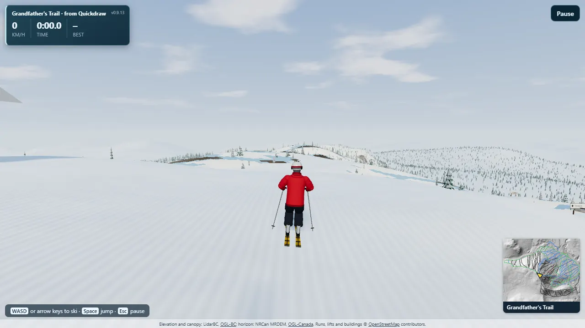
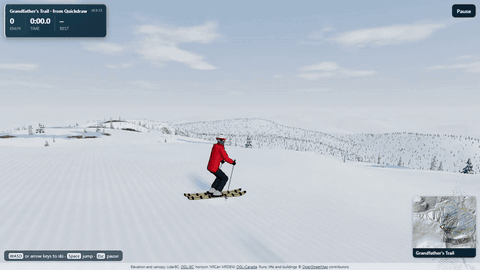
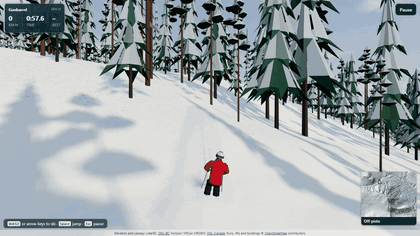
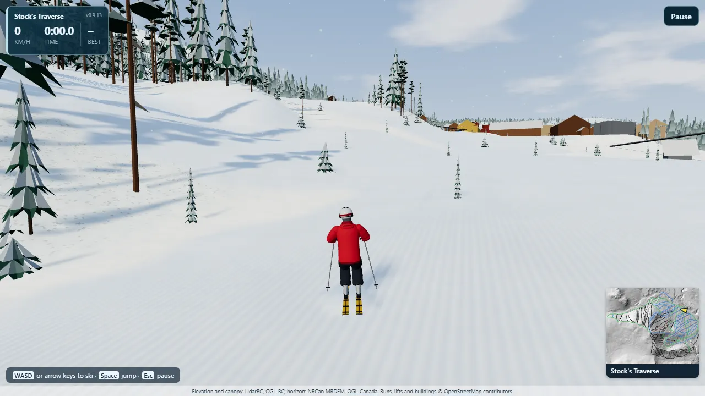
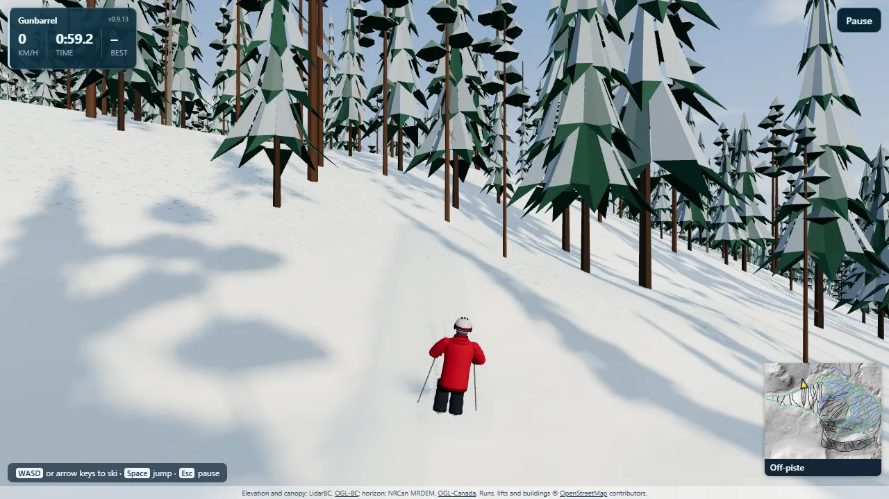
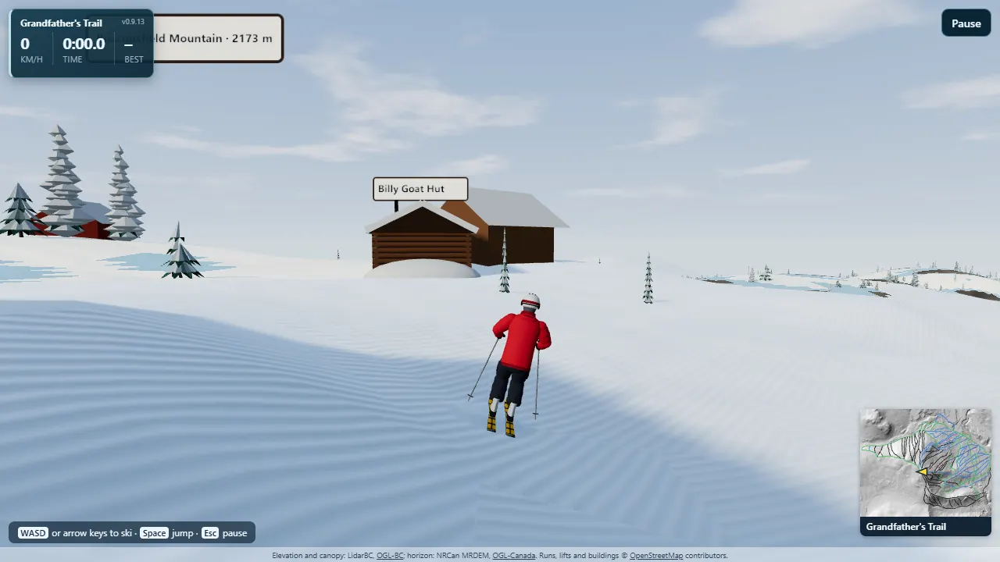
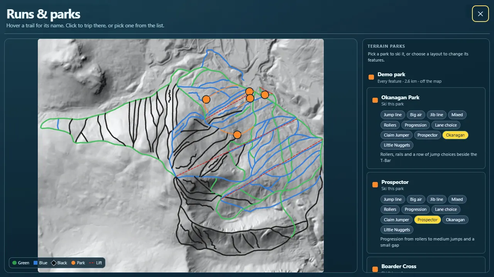

# SkiScrapex

A browser skiing game set at Apex Mountain Resort near Penticton, BC, built from real LiDAR elevation, forest canopy and OpenStreetMap data. Three.js and TypeScript, no install needed to play.

The aim is an Apex that locals recognise, and skiing that feels good on groomers, in powder and in the terrain park.

**Play it:** https://johnstonstu.github.io/SkiScrapeX/ (desktop or phone, nothing to install).

Current version: **0.9.38** (see [CHANGELOG.md](CHANGELOG.md)). Plan to 1.0: [docs/roadmap.md](docs/roadmap.md).



<p>
  
  
</p>

| Village from Stock's Traverse | Trees off Gunbarrel | Billy Goat Hut on the summit |
| --- | --- | --- |
|  |  |  |



Short MP4 copies of the clips live beside the GIFs (`docs/media/carve.mp4`, `docs/media/powder.mp4`) if you want a sharper download.

## Play locally

Needs Node 20 or newer.

```bash
cd game
npm ci
git fetch origin data && git --work-tree=public/data checkout FETCH_HEAD -- . && git reset -q   # generated terrain and map data
npm run dev      # http://localhost:5173
```

Without `public/data` the game falls back to synthetic test slopes.

## Controls

**Keyboard**

| Key | Action |
| --- | --- |
| <kbd>A</kbd> <kbd>D</kbd> or <kbd>←</kbd> <kbd>→</kbd> | Turn. Tap for a light carve, hold to commit; at speed a full turn skids and scrubs speed |
| <kbd>W</kbd> or <kbd>↑</kbd> | Push or skate when slow, tuck at speed, fast-forward lift rides |
| <kbd>S</kbd> or <kbd>↓</kbd> | Brake (hockey stop) |
| <kbd>Space</kbd> | Hold to crouch and absorb mogul crests, release to jump. In deep powder a tap unweights the skis |
| <kbd>Space</kbd> with <kbd>A</kbd> or <kbd>D</kbd> | Hop 180. Riding switch (backwards), a tap hops you round to forward. From forward, hold the crouch a moment first to hop to switch |
| <kbd>J</kbd> or <kbd>Shift</kbd> | Grab: alone a mute, with <kbd>W</kbd> a japan, <kbd>S</kbd> a tail grab, a direction a safety |
| <kbd>K</kbd> | Second grab button: alone a critical, with <kbd>W</kbd> a nose grab, with <kbd>S</kbd> a truck driver |
| In the air | <kbd>A</kbd> <kbd>D</kbd> spin, <kbd>W</kbd> <kbd>S</kbd> flip; during a spin <kbd>W</kbd> <kbd>S</kbd> corks it (let go before landing). Hold a direction while crouched to pre-wind a spin |
| <kbd>T</kbd> runs and parks · <kbd>O</kbd> rider and skis · <kbd>C</kbd> camera · <kbd>M</kbd> map · <kbd>R</kbd> restart · <kbd>P</kbd> music player, <kbd>[</kbd> <kbd>]</kbd> previous and next song · <kbd>I</kbd> info · <kbd>Esc</kbd> pause · <kbd>Enter</kbd> skip lift ride | |

**Phone or tablet:** a floating stick on the left (left and right turn, up tuck, down brake; in the air it spins and flips) and **Jump** and **Grab** buttons on the right. Phones get a minimal in-run screen by default (Settings, Screen while skiing). Add the game to the home screen to play it like an app; on Android the pause menu also offers Fullscreen, and the screen stays on while skiing.

**Controller:** Left stick steers, tucks, spins, and flips. LT / L2 brakes. A / × jumps. X / □ or RB / R1 grabs, and Y / △ selects the second grab. Open Pause with Start / Options. Clicking the right stick (R3) opens the music player, and D-pad left and right skip back or forward a song. Restart a run from the pause menu. Use the D-pad or left stick to navigate, A / × to select, and B / ○ to go back. The pause menu shows bindings and terrain park instructions for all three input types.

The title screen offers Free ski, Challenges (Apex events such as the Downhill, Shoot the Chute, slalom, GS, Kristi's Moguls and Aerials, plus timed runs, park score attacks, the run checklist and gold nuggets), the rider creator and Settings. Free ski first asks for skis or a snowboard and a rider, then opens with a short film of the Quickdraw chair arriving at the top (Enter skips it), and teaches the controls with one-line prompts on the way down. A longer tutorial by the Magic Carpet is on the title menu. The rider panel (<kbd>O</kbd>) changes every part of the look.

In free ski you start at the top of Quickdraw on Grandfather's Trail. Reaching the bottom of any lift records your time, then you ride up and carry on. A green ring shows where you will land when your rotation will line up.

## Developer tools

| Tool | What it does |
| --- | --- |
| `?at=x,z,heading` | Start anywhere on the crop (metres, heading in degrees) |
| `?ride=quickdraw`, `?park=claim` | Start on a lift or at the top of a park |
| `?dev` | Synthetic test slopes |
| `?turns=wide` | Try wider turns at speed. Open the same route without the parameter for Classic. |
| `?touch`, `?noshadows` | Force touch controls (and the mobile quality path), turn off shadows |
| `?perf` | Exposes load timings, frame CPU split and renderer counts as `window.__perf` |
| `rider.html` | Rider lab: every pose side by side. `?anim` plays them, `?h=90` side view, outfit keys like `?fit=slim&headwear=beanie&jacket=2f7fe0` |
| `npm test` | Unit tests, plus real-data checks when `public/data` is present |
| `npm run tune` | Physics bots: real runs, powder, every park layout, and a steep-slope probe from 20° to 45° |
| `npm run build` | Production build into `game/dist` |
| `python3 scripts/detect-runs.py game/public/data out.json preview.png` | Finds cleared run corridors in the canopy that OSM lacks (needs NumPy, SciPy, scikit-image) |
| `node scripts/readme-media.mjs` | Capture README stills and short clips from a built `dist` (needs Playwright + ffmpeg) |

## How it is built

| Layer | Source | Code |
| --- | --- | --- |
| Ground | LidarBC 2025 1 m bare earth, resampled to 5 m for the crop and 2 m (smoothed for snowpack) near the skier | `scripts/build-terrain.py` |
| Horizon | NRCan MRDEM 30 m out to about 12 km | `scripts/build-horizon.py` |
| Forest | LidarBC surface minus bare earth: canopy height and cover per 5 m cell | `scripts/build-terrain.py` |
| Runs, lifts, buildings, roads | OpenStreetMap, plus runs traced from canopy gaps | `tools/osm/`, `scripts/detect-runs.py`, `game/src/world/runOverlay.ts` |

The **Build Apex data** workflow downloads the sources and publishes the outputs to the orphan `data` branch (builds from another branch go to `data-<branch>`). Generated terrain never goes on `main`. The OpenStreetMap export retries public Overpass mirrors and then the main OSM map API. If that still fails, the job stops and the `data` branch keeps its last good build. The Pages build will not deploy a site whose `features.json` is missing, has no buildings or has a lift count other than four.

### Source layout (`game/src`)

| Folder | Role |
| --- | --- |
| `main.ts` | Entry: renderer, scene, player, frame loop |
| `app/` | Wiring: Apex stage assembly, menus, trick feed, storage, version, `?perf` probe |
| `sim/` | Ski physics at 120 Hz: carving, powder, freestyle, rails. No Three.js; reads only `sampleTerrain(x, z)` |
| `world/` | Data to world: terrain grids, runs and lifts, surface mask, forest, buildings, village, parks. No Three.js, unit tested |
| `render/terrain/` | Terrain mesh with 2 m tiles, apron, moguls, test slopes |
| `render/scenery/` | Trees, lifts, buildings, village props, roads, signs, park features |
| `render/rider/` | Skier model and animation, landing marker |
| `fx/` | Snow shader, spray, snowfall, ski tracks |
| `player/` | Input, camera, audio, snow effects |
| `ui/` | Minimap, rider panel |
| `tools/` | Rider lab |

More detail: [docs/status.md](docs/status.md) (technical state and open issues), [docs/terrain.md](docs/terrain.md) (data contract), [game/research/](game/research/) (physics, controls and reference research).

## Conventions

Metres. +X east, +Y up, +Z south. Heading 0 faces south; positive headings turn to the skier's right. Horizontal CRS NAD83(CSRS) / UTM 11N (EPSG:2955), heights CGVD2013.

Work happens on branches and merges to `main` at milestones, each tagged `vX.Y.Z` with a CHANGELOG entry. Run `npm test` and `npm run build` in `game/` before merging. Every push runs the tests in GitHub Actions; the Pages deploy runs only when the repository variable `PAGES_ENABLED` is `true`.

## Credits and licences

The code is under the [MIT licence](LICENSE). Third-party code it includes is listed in [game/THIRD_PARTY_NOTICES.md](game/THIRD_PARTY_NOTICES.md).

The map data keeps its own licences and is published separately on the `data` branch:

- Elevation and canopy contain information licensed under the [Open Government Licence – British Columbia](https://www2.gov.bc.ca/gov/content/data/open-data/open-government-licence-bc) (LidarBC).
- Horizon terrain from NRCan MRDEM under the [Open Government Licence – Canada](https://open.canada.ca/en/open-government-licence-canada).
- Runs, lifts and buildings © [OpenStreetMap](https://www.openstreetmap.org/copyright) contributors, available under the Open Database License (ODbL 1.0). The exported `features.json` is a derived database under the same licence.

Apex Mountain Resort's name and run names are used descriptively. This is a fan project and is not affiliated with or endorsed by the resort; no Apex logos or trail-map artwork are included.
