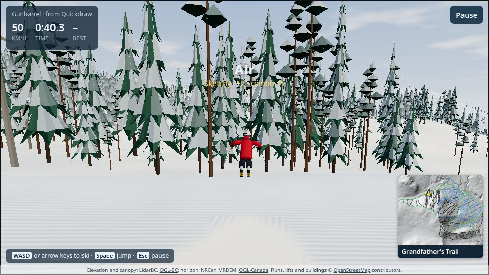
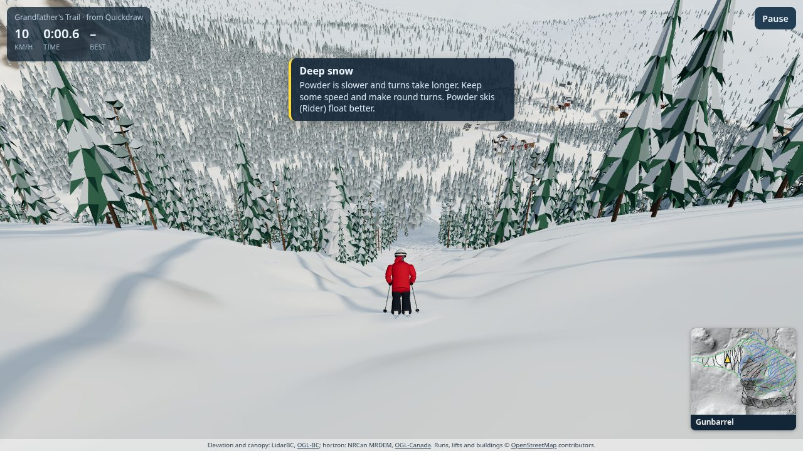
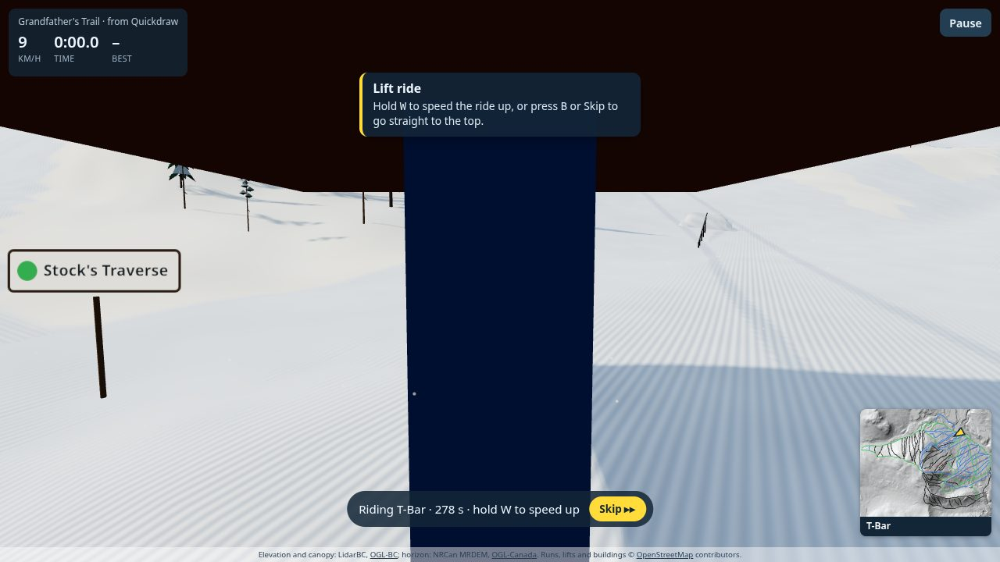
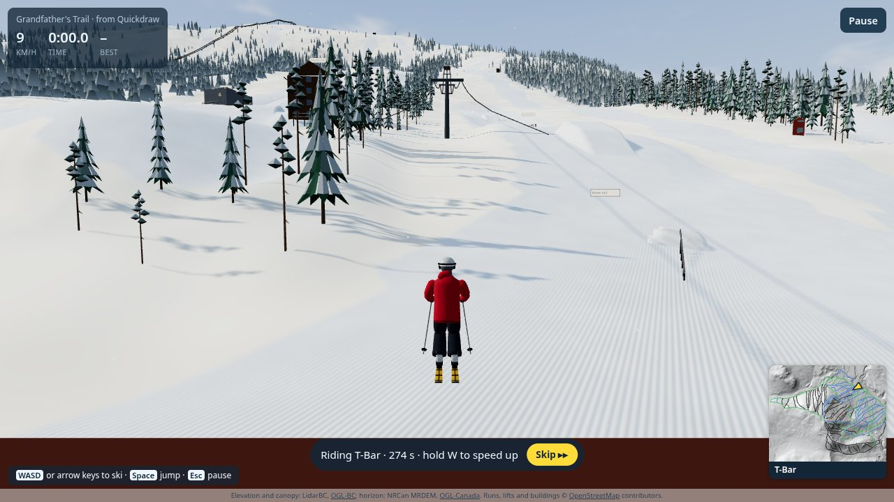
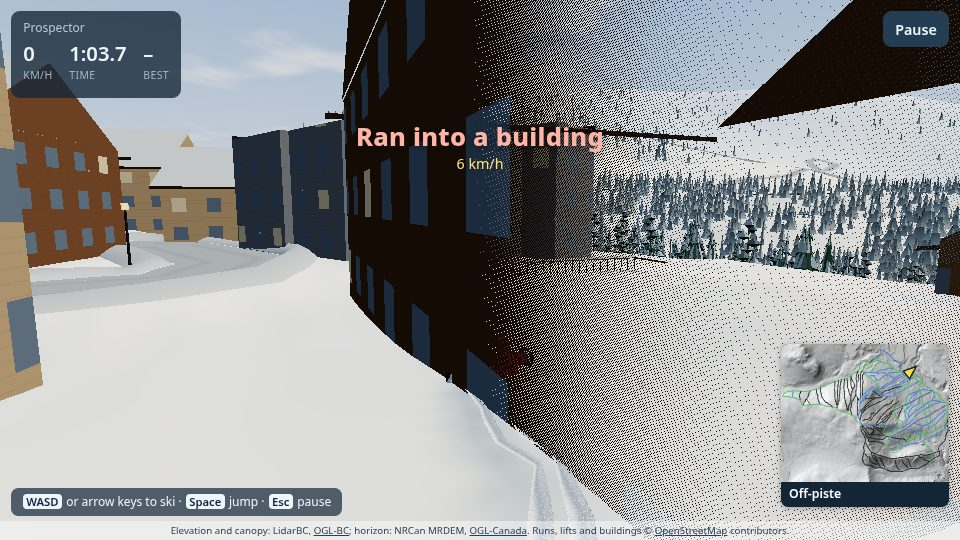

# SkiScrapeX playtest: live build (v0.8.2, which includes the v0.8.1 features)

> **Note.** Tested in headless Chromium with software WebGL, so frame rates and some rendering artifacts may not reflect real hardware. The [H] marks below are the items most likely to come from that setup. Source paths were checked against `main` at `437451c` (v0.8.2) and pointed at the current files. The findings are unchanged.

Tested 2026-11-22, 12:40 to 13:10 PT. Target: https://johnstonstu.github.io/SkiScrapeX/

**Which version this covers.** The brief asked for v0.8.1. By the time testing started, `main` was already at 437451c (v0.8.2, "smaller jumps, quicker turns", pushed 12:35 PT), and the live page showed **v0.8.2**. So everything below is v0.8.2. That build still has the v0.8.1 rail presses and the data fix.

**How it was tested.** Headless Chromium with SwiftShader WebGL, driven by Playwright. Inputs were real keyboard events: an in-page autopilot sent keydown/keyup for WASD and Space, and Playwright sent C, T and I. All state was read from `?test` → `window.__game.skier`. Gameplay runs used Low quality, no shadows and a 960×540 window, which gave about 5 fps, so game time ran at roughly real speed. Visual checks used the default (Auto → High) settings, which ran at about 0.7 fps. Several jobs ran in parallel late in the session and slowed game time a lot. **Anything about frame timing, input latency or rendering artefacts may come from headless rendering; those items are marked [H].** The autopilot steers crudely, so these runs measure the game, not a skilled player.

## Summary
- **Load: good.** v0.8.2 is shown, and `data/features.json` loads with HTTP 200 (77 KB, no fallback to test slopes). There were zero console errors, warnings or HTTP errors in every session. Total download is about 6.9 MB over 15 requests, and the title was ready about 7.5 s after navigation (headless).
- **Rail presses work.** Holding W on a rail produced "Nose Press 50-50 Rail". The press made the rail harder to balance, as designed, and in my test it ended in "(fell)".
- **Bugs found:**
  - Braking (S) while bouncing off moguls triggers an unintended **Backflip**.
  - Flat-ground ollie spam farms huge combo bonuses (**Combo ×5 = +5,385** from tricks worth +2 to +150 each).
  - `?at=` still shows the wrong run name in the HUD.
  - The camera sits inside the T-bar base terminal at the start of the ride.
  - The rider rides beside the T-bar line with no hanger.
  - The Prospector park run-out leads straight into village buildings.
- **Earlier P0 items:**
  - Fixed: none fully, apart from "Stock's Chiar", which an earlier PR had already corrected.
  - Still present: "Dude ney Trail", the `?at=` HUD name, the dither ghost trees, and the T-bar base problems.
  - First-person landing ring: inconclusive.

## Load
| Check | Result |
|---|---|
| Version in pause menu | `v0.8.2` |
| `data/features.json` | 200, 76.9 KB. It contains 67 runs, 5 parks, 4 lifts, 147 buildings, 31 roads and 1 peak. No "Apex data not found" fallback. |
| Console errors/warnings | 0 across about 15 page loads (title, `?test`, `?at`, `?park`, `?ride`, `?perf`, `?touch`) |
| HTTP ≥ 400 | none |
| Download | 6.89 MB transferred. The biggest files are `heights-2m.u16` 3.9 MB, `heights.f32` 1.1 MB, `horizon.f32` 0.7 MB and JS 0.23 MB. |
| Time to title ready | about 7.5 s headless. The `?perf` phases show loadWorld 545 ms and total 1,630 ms. |

Screenshots: [00_title-loading.jpg](playtest-0.8.2/00_title-loading.jpg), [01_title-ready.jpg](playtest-0.8.2/01_title-ready.jpg). The title reads "Runs skied 0/84, Nuggets 0/12".

## Bugs

### B1. Braking on moguls flips you: S is both the brake and the air pitch (Medium-High)
- **URL:** `?test`, then Runs → Gunbarrel.
- **Steps:**
  1. Ski Gunbarrel at 60–90 km/h.
  2. Tap S (Down) to scrub speed as you crest the moguls.
- **Expected:** braking slows you down. No trick unless you pop and ask for one.
- **Actual:** the moguls launch you constantly (24 of 82 samples were airborne). Holding S during one of those hops logged **"Backflip · Sketchy +521"** at t≈41 s. The autopilot never pressed Space; it only held S to brake when speed went over 79 km/h. The mogul hops also score "Air … combo ×5".
- **Screenshot:**  (an unintended "Air · Sketchy · combo ×5" on the run-out).
- **Data:** [log_gunbarrel.json](playtest-0.8.2/log_gunbarrel.json).
- **Suspected source:** pitch input while airborne in `game/src/sim/freestyle.ts` / `game/src/sim/skier.ts`. The air-pitch input doesn't check whether the skier popped, or whether S was already held at takeoff. There is a `flipLock` for rails ("pitch already held … does nothing until you let go"), but nothing like it for takeoffs.
- **Suggestion:** reuse the flipLock rule for any takeoff without a pop. Pitch already held at takeoff should not rotate you until it is released and pressed again.

### B2. Combo farming with flat-ground ollies (Medium)
- **URL:** `?test`, then Runs → Prospector, layout "Jump line".
- **Steps:**
  1. Hold and release Space every 2.5 to 3.4 s while skiing.
  2. Hold J in the air.
- **Expected:** repeated low ollies are worth little.
- **Actual:**
  - Repeat scoring does decay: +143, +65, +39, +19, +5, +4, +2.
  - But the combo still climbed to ×5 and paid **"Combo ×5 +5,385 · 5,908 total"**.
  - Most of those "Air" tricks were pops of about 0.3 m with 0.5 s of air.
  - One "180 Mute" came out of a steering windup.
- **Data:** [park_prospector-jump-line-jump.json](playtest-0.8.2/park_prospector-jump-line-jump.json).
- **Screenshots:** [air1](playtest-0.8.2/park_prospector-jump-line-jump_air1.jpg), [air2](playtest-0.8.2/park_prospector-jump-line-jump_air2.jpg), [air3](playtest-0.8.2/park_prospector-jump-line-jump_air3.jpg), [air4](playtest-0.8.2/park_prospector-jump-line-jump_air4.jpg), [air5](playtest-0.8.2/park_prospector-jump-line-jump_air5.jpg).
- **Suspected source:** `game/src/app/tricks.ts`, the combo bonus. It looks like the bonus multiplies the undecayed trick values, or a running total, instead of what each trick actually scored.

### B3. `?at=` still shows "Grandfather's Trail · from Quickdraw" (Low, review tooling; earlier P0)
- **URLs:** `?test&at=1124,955,180` (Gunbarrel), `?test&at=1539,1113,180` (Juniper), `?test&at=2589,1774,90` (Whipsaw).
- **Expected:** the HUD names the run you're on.
- **Actual:** the HUD shows "Grandfather's Trail · from Quickdraw" every time, while the minimap correctly says Gunbarrel, Juniper and Whipsaw.
- **Screenshots:** , [at_juniper_hud.jpg](playtest-0.8.2/at_juniper_hud.jpg), [at_whipsaw_hud.jpg](playtest-0.8.2/at_whipsaw_hud.jpg).
- **Source:** `game/src/main.ts`. `spawnOverride()` (about line 796) only replaces `spawn` and keeps `start.startRun` and `startLift`. Line 361 then builds the title from `course.startRun`. Fix: set `startRun` from `runNameAt(x, z)` and clear `startLift`.

### B4. The follow camera starts inside the T-bar base terminal (Medium, visual; earlier P0)
- **URL:** `?test&ride=t-bar`
- **Actual:** for the first seconds of the ride, a large dark-navy slab fills the middle of the screen and a dark brown roof covers the top third. The camera is inside or behind the bottom-terminal geometry.
- **Screenshot:** .
- **Suspected source:** `game/src/player/camera.ts` (the follow cam doesn't collide with or fade solids), together with the T-bar terminal mesh in `game/src/render/scenery/liftView.ts` (`terminal()`).

### B5. T-bar ride: no hanger, rider off the line, dark strip at the bottom (Low-Medium, visual)
- **URL:** `?test&ride=t-bar`, about 30 s in.
- **Actual:**
  - The rider stands upright in the middle of the track with no T-bar hanger.
  - The haul cable and towers run to the rider's right.
  - A dark brown band covers the bottom of the screen behind the ride bar, probably the terminal roof clipping the near plane. [H possible]
- **Screenshot:** .

### B6. The Prospector park run-out leads into the village buildings (Low-Medium)
- **URL:** `?test`, then Runs → Prospector (any layout).
- **Steps:** ski the park line straight through and keep going.
- **Actual:**
  - About 55–75 s in, near x≈2475, z≈530, the skier hits building walls repeatedly: "Ran into a building" at 44, 12, 11, 8, 7 and 6 km/h.
  - The HUD still says "Prospector" while the minimap says "Off-piste".
  - The building wall turns into a heavy dither stipple when the camera is against it.
- **Screenshot:** .
- **Note:** my pilot just holds the park heading, so a player would steer away. But nothing guides you out at the end, and building collisions at 6–12 km/h each count as a separate crash, so it feels like being stuck.

### B7. Two quick C presses within one frame only cycle the camera once (Low) [H]
- At about 5 fps, `press C, press C` went First person → Orbit only, not → Follow. In `game/src/player/input.ts`, actions are a `Set`, so repeated presses within one frame collapse into one. This only shows at low fps.

### B8. Rail trick says "(fell)" and then "Landed" (Low, wording)
- Prospector Jib line, nose press: the feed showed "Nose Press 50-50 Rail (fell) · Sketchy +206" and then "Landed +206 · 725 total". The skier did not crash.
- The wording conflicts: "(fell)" here means "fell off the rail", not that the skier fell.
- Source: `game/src/sim/skier.ts:735`. Suggestion: "slipped off" or "(off early)".

### B9. "Dude ney Trail" and "Unmapped run L…" in the run list (Low; earlier P0)
- The Runs list (119 buttons) still contains "Dude ney Trail".
- It also lists 13 runs called "Unmapped run L1" to "L14".
- It lists "Dawdler1" and "Dawdler2" with no space.
- `features.json` still spells the lift "Stock's Chiar". The game corrects it: the HUD reads "from Stock's Chair".
- Source: `game/src/world/corrections.ts` for run names ("Dude ney Trail" is not listed there). The in-game Stock's rename is in `game/src/world/resort.ts`.

## Gameplay feel
- **Rail presses (v0.8.1):**
  - At about 62 km/h the rail lasted only about 0.5 s (3.6 m), and holding W did not register a press. At 5 fps that is 2 to 3 frames [H].
  - When I braked into the rail at about 21 km/h (5.7 m/s), "Nose Press 50-50 Rail" registered and lasted about 1 s before falling off. The pilot didn't counter-steer to balance.
  - The rail tip ("Hold W or S for a nose or tail press…") appeared at the right moment.
  - The park start point is already at about 15–20 km/h, and the jib line takes you to about 60 km/h by the first rail unless you brake. That's fast for a jib line.
- **Tail press:** I didn't test it. S is the brake, and the design makes S held on landing do nothing until it is released, so a player who brakes into a rail has to release S and press it again to get a tail press. That's worth a real-hands check.
- **Jumps (v0.8.2 tuning):**
  - Flat pops gave about 0.5 s of air and an equivalent fall height of about 0.3 m, which matches the changelog's "about 0.3 m ollie".
  - Landings were overwhelmingly clean: 14 of 16 clean, 2 sketchy, 0 crashes on landing.
  - "Mute" registered with J held.
  - It feels forgiving rather than too big now.
- **Speed:**
  - Gunbarrel (expert) got to 90–97 km/h in a straight line even with braking above 79 km/h, finishing in 39.8 s. Juniper reached 80 km/h.
  - Grandfather's Trail is long and flat. It averaged 31 km/h, and after 3:16 of game time it was only about 40% of the way along the line (38 of 96 points). As a "from the top" green run it's a long cruise.
  - No crashes, stuck spots or falling through the terrain on Grandfather's, Juniper or Gunbarrel. There was one 4.5 s stop on Gunbarrel at x1129, z825 in the first run and one crash at x1145, z736.
- **Run-completion card:** "Skied Gunbarrel 1/84 runs" appeared at the bottom of Gunbarrel. Good.
- **HUD:**
  - The title always shows the course you picked, not the run you're on. You ski from Gunbarrel onto Grandfather's and the HUD still says Gunbarrel, while the minimap caption updates.
  - On lifts the HUD shows the last course, a speed of 9–18 km/h, and a time of 0:00.0.
  - It would be clearer to show the lift name on lifts.
- **Coach tips:** all of these appeared and read well: Terrain park, Steep pitch, Deep snow, Tree skiing, Wipeout and On a rail.
- **Lifts:**
  - `?ride=quickdraw` works. It shows "Riding Quickdraw · 323 s · hold W to speed up · Skip" ([ride_quickdraw_1mid.jpg](playtest-0.8.2/ride_quickdraw_1mid.jpg)).
  - The chair is a flat navy box that hides most of the rider.
  - The ride is 5.4 min at 1×, and a T-bar ride is 4.6 min. Hold-W and Skip exist, but default times are long for a game.
- **Cameras:** C cycles Follow → First person → Orbit → Follow, and the pause-menu label updates ([first person](playtest-0.8.2/cam_0_Camera-First-person.jpg), [orbit](playtest-0.8.2/cam_1_Camera-Orbit.jpg), [follow](playtest-0.8.2/cam_2_Camera-Follow.jpg)).
- **Touch (`?touch`, 844×390, mobile):**
  - The touch layer shows a floating stick (left 62% of the screen), plus Jump and Grab buttons.
  - Dragging the stick steered and moved the skier: carving at 13 km/h with the heading changed by about 180° ([touch_steering.jpg](playtest-0.8.2/touch_steering.jpg)).
  - The Grab button (y 182–248) overlaps the bottom edge of the minimap (y 59–190) by about 8 px.
  - The HUD takes about 27% of the screen width on a phone.
- **Settings:** Graphics Auto/Low/Medium/High ("now high"), Shadows, View distance, Steering sensitivity, Flip controls, FOV, Camera shake, Volume, Other skiers, Landing marker, Landing assist, and Reset ([settings_panel.jpg](playtest-0.8.2/settings_panel.jpg)). Everything there is labelled clearly.

## P0 recheck (from docs/review/apex-visual-improvements.md)
| P0 item | Status in v0.8.2 | Evidence |
|---|---|---|
| Live `features.json` 404 | **Fixed** (200, full data) | [t1_load.json](playtest-0.8.2/t1_load.json) |
| Dither "ghost" trees | **Still present.** Trees near the camera render as a coarse dither stipple (seen at Low quality in first person; building walls do it too). [H possible] | [ring_first-person_3.jpg](playtest-0.8.2/ring_first-person_3.jpg), [park_prospector-jump-line-jump_9end.jpg](playtest-0.8.2/park_prospector-jump-line-jump_9end.jpg) |
| T-bar base triangle and black strips | **Still present in some form.** The camera is inside the base terminal at ride start, with a dark band at the bottom of the screen mid-ride. | [ride_t-bar_0start.jpg](playtest-0.8.2/ride_t-bar_0start.jpg), [ride_t-bar_1mid.jpg](playtest-0.8.2/ride_t-bar_1mid.jpg) |
| Wrong HUD run name with `?at=` | **Not fixed** | [at_gunbarrel_hud.jpg](playtest-0.8.2/at_gunbarrel_hud.jpg) |
| First-person landing ring | **Inconclusive.** In 5 first-person airborne frames on Claim Jumper no ring was visible. The pops were small and the skier drifted into the trees. The code (`game/src/main.ts:680`) shows the ring whenever you're airborne and the setting is on, whatever the camera. | [1](playtest-0.8.2/ring_first-person_1.jpg), [2](playtest-0.8.2/ring_first-person_2.jpg), [3](playtest-0.8.2/ring_first-person_3.jpg), [4](playtest-0.8.2/ring_first-person_4.jpg), [5](playtest-0.8.2/ring_first-person_5.jpg), [back to follow](playtest-0.8.2/ring_back-to-follow.jpg) |
| "Dude ney Trail" | **Not fixed** | run list, [routes.json](playtest-0.8.2/routes.json) |
| "Stock's Chiar" | Fixed in game (HUD "from Stock's Chair"); the raw OSM data still has the typo | [jobA.out](playtest-0.8.2/jobA.out) |

## Performance [H: SwiftShader software WebGL, not representative of a GPU]
| Spot | Settings | fps | Frame | Draws | Tris |
|---|---|---|---|---|---|
| Spawn, Quickdraw top (`?perf&test`) | Auto → High, 1280×720 | 0.7 | 75 ms CPU | 253 | 1,405k |
| Same spot | Low, no shadows, 800×450 | 5.2 | – | – | – |
| Quickdraw spawn | High, 1280×720, idle measurement | 1.0 | – | – | – |

The spawn view has 70,318 of 232,211 trees drawn, 138 buildings, 593 cars and 9 2-m tiles. The village, park and Gunbarrel perf readings were cut short because parallel jobs were slowing everything down (no data). On real hardware, use `?perf` with the I overlay to get these numbers.

## Top 5 recommendations
1. **Separate brake and air pitch** (B1): no flip from pitch already held at takeoff unless you popped. This will matter to every player who brakes on moguls.
2. **Fix the combo bonus** (B2) so it pays what each trick actually scored, and maybe require a kicker or rail, or a minimum height, for a trick to extend a combo.
3. **Fix the `?at=` HUD title** (B3): a one-line change in `spawnOverride`. While you're there, show the lift name during rides and consider showing the current run rather than the picked course.
4. **Fix the T-bar** (B4/B5): keep the follow camera out of terminal geometry (collide with or fade the camera against solids), add a hanger, and line the rider up with the haul line.
5. **Park flow:** slow the jib-line run-in, or put a speed-check sign before the first rail, and add an end-of-park run-out that steers away from the buildings (B6). Then do a real-hands test of the tail press with S being the brake.

## Files
- Screenshots (50) are in [playtest-0.8.2/](playtest-0.8.2/). None were over 500 KB, so they are the original JPEGs. Shots not linked in the sections above:
  - [perf_spawn.jpg](playtest-0.8.2/perf_spawn.jpg)
  - Quickdraw: [start](playtest-0.8.2/ride_quickdraw_0start.jpg), [end](playtest-0.8.2/ride_quickdraw_9end.jpg)
  - Gunbarrel: [start](playtest-0.8.2/run_gunbarrel_0start.jpg), [mid 1](playtest-0.8.2/run_gunbarrel_1mid.jpg), [mid 2](playtest-0.8.2/run_gunbarrel_2mid.jpg)
  - Juniper: [start](playtest-0.8.2/run_juniper_0start.jpg), [mid](playtest-0.8.2/run_juniper_1mid.jpg), [end](playtest-0.8.2/run_juniper_9end.jpg)
  - Grandfather's Trail: [start](playtest-0.8.2/run_grandfather-s-trail_0start.jpg), [mid 1](playtest-0.8.2/run_grandfather-s-trail_1mid.jpg), [mid 2](playtest-0.8.2/run_grandfather-s-trail_2mid.jpg), [end](playtest-0.8.2/run_grandfather-s-trail_9end.jpg)
  - Dude ney Trail: [start](playtest-0.8.2/run_dude-ney-trail_0start.jpg), [mid 1](playtest-0.8.2/run_dude-ney-trail_1mid.jpg), [mid 2](playtest-0.8.2/run_dude-ney-trail_2mid.jpg)
  - Prospector jump line start: [park_prospector-jump-line-jump_0start.jpg](playtest-0.8.2/park_prospector-jump-line-jump_0start.jpg)
  - Prospector jib line: [start](playtest-0.8.2/park_prospector-jib-line-press_0start.jpg), [rail](playtest-0.8.2/park_prospector-jib-line-press_rail1.jpg), [air 1](playtest-0.8.2/park_prospector-jib-line-press_air1.jpg), [air 2](playtest-0.8.2/park_prospector-jib-line-press_air2.jpg), [end](playtest-0.8.2/park_prospector-jib-line-press_9end.jpg)
  - Touch: [title](playtest-0.8.2/touch_title.jpg), [in game](playtest-0.8.2/touch_ingame.jpg)
- Logs kept with this note, because the report cites them and they are small: [log_gunbarrel.json](playtest-0.8.2/log_gunbarrel.json), [park_prospector-jump-line-jump.json](playtest-0.8.2/park_prospector-jump-line-jump.json), [t1_load.json](playtest-0.8.2/t1_load.json), [routes.json](playtest-0.8.2/routes.json), [jobA.out](playtest-0.8.2/jobA.out), [t5a.json](playtest-0.8.2/t5a.json) (the `?at=` HUD readings). Larger sample dumps (`log_juniper.json`, `log_grandfather-s-trail.json`, `park_prospector-jib-line-press.json`) and the Playwright scripts were left out. The scripts were not in the uploaded bundle.
- Not done: a Dude ney Trail ski-through (stopped for time), the Stock's chair ride, and video clips.
